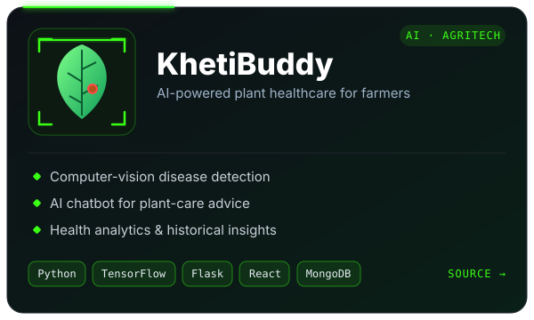
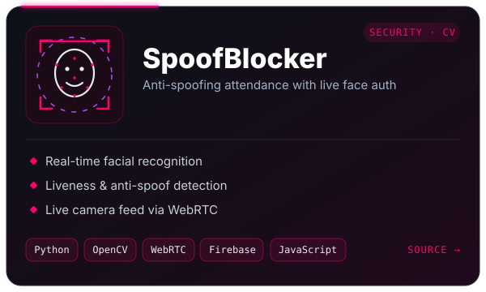
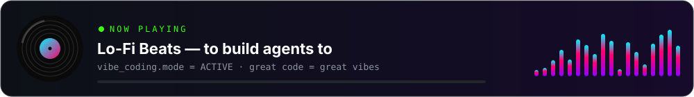
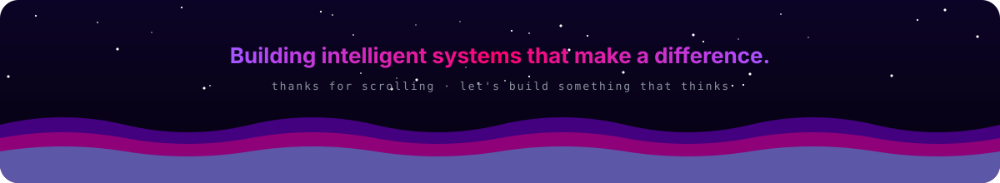

<!-- ══════════════════════════════════════════════════════════════
     HERO
═══════════════════════════════════════════════════════════════ -->

  

  

  
  
  
  

<!-- ══════════════════════════════════════════════════════════════
     WHOAMI
═══════════════════════════════════════════════════════════════ -->
<h2 align="center">👾 whoami</h2>

  

<!-- ══════════════════════════════════════════════════════════════
     SIH 2024
═══════════════════════════════════════════════════════════════ -->
<h2 align="center">🏆 Major Achievement</h2>

  

<!-- ══════════════════════════════════════════════════════════════
     PROJECTS   (replace the hrefs with the real repo links)
═══════════════════════════════════════════════════════════════ -->
<h2 align="center">🚀 Featured Projects</h2>

  
  

  

<!-- ══════════════════════════════════════════════════════════════
     TECH
═══════════════════════════════════════════════════════════════ -->
<h2 align="center">🛠️ Tech Arsenal</h2>

  

  
  
  
  
  

<!-- ══════════════════════════════════════════════════════════════
     STATS
═══════════════════════════════════════════════════════════════ -->
<h2 align="center">📊 GitHub Pulse</h2>

  
  

  

  

  <picture>
    <source media="(prefers-color-scheme: dark)" srcset="https://raw.githubusercontent.com/himaxx/himaxx/output/snake-dark.svg"/>
    <source media="(prefers-color-scheme: light)" srcset="https://raw.githubusercontent.com/himaxx/himaxx/output/snake.svg"/>
    
  </picture>

<!-- ══════════════════════════════════════════════════════════════
     VIBE + CONNECT
═══════════════════════════════════════════════════════════════ -->

  

<h2 align="center">🌐 Let's Connect</h2>

  <!-- TODO: put your real LinkedIn / email / X links here -->
  
  
  
  
  

  

